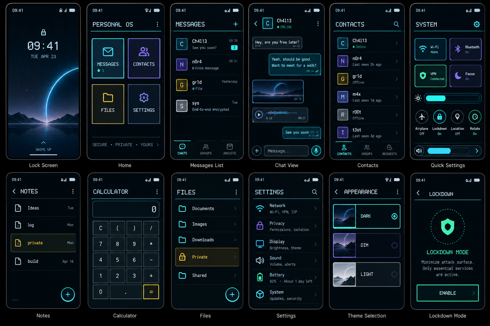
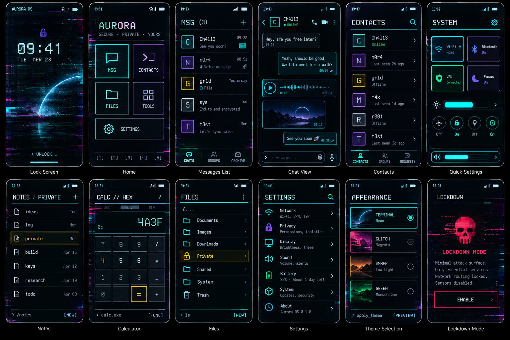

# NexatrodeOS design concepts

These images are visual references for possible screens and styling. They are
concepts, not a list of features implemented in NexatrodeOS.

## Clean interface

## Neon interface

